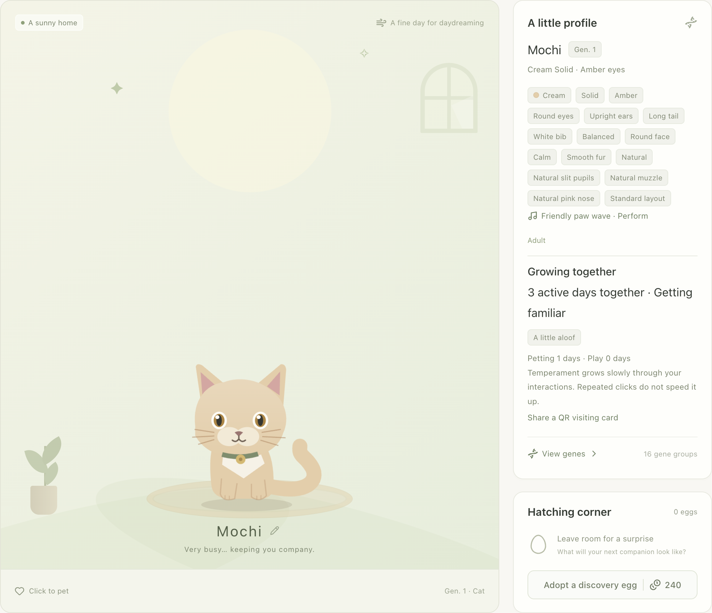

<a id="pawprint"></a>

# 爪印 Pawprint — 你的工作，有个小伙伴

**一点桌面陪伴，也帮你回到对的 Codex 会话。**

[下载 v0.15.2](https://github.com/huangbinjie/pawprint/releases/tag/v0.15.2) · [官网](https://huangbinjie.github.io/pawprint/zh/) · [English](README.md)

爪印是一款独立开发的桌面伙伴，支持 Windows x64 和 Apple 芯片 Mac。猫咪随本机 Codex 活动成长，身边留着几个实用的工作入口。宠物、提醒和小游戏无需 API key，不额外发起模型请求。


## Codex 助手

在一个页面管理连接、会话提醒、用量和高级设置。**macOS** 可添加支持 Responses API 的第三方 Provider，密钥保存到 Keychain；无需退出 Codex 即可修改新会话的默认连接。修改配置前会备份，保留原来的 ChatGPT 登录。已有会话不会自动切换，远端会话不保证使用本机配置。

可为确认来源的本地第三方会话标题加上 Provider 前缀。用量按连接名称和模型汇总 Token，并提供基于模型价格表的参考费用；未知模型保留未定价。参考费用不等于实际扣费或余额。本机路径默认收起，公开示例只使用通用数据。

第三方连接默认保留 Dot 等账号入口，实际可用性取决于账号与客户端权限。菜单栏会立即显示所选 Provider 名称，切回 ChatGPT / OpenAI 后恢复本机额度快照显示；第三方余额和额度请以服务商后台为准。

第三方连接配置的模型 ID 在 Codex 模型列表中时，保留聊天框的模型选择；不在列表中（例如 MiMo）时，聊天、标题生成和上下文压缩才固定使用配置模型，即使聊天框仍显示 GPT。读取列表失败时保留聊天框选择并提示重试。无需替换或重载模型目录；切回 ChatGPT / OpenAI 后继续使用客户端原生模型选择。

详见 [Codex 账号管理功能及限制](docs/codex-account-manager.md)。

## 小小的爪子，实用的帮助

| 当你…… | 猫咪可以帮你…… |
| --- | --- |
| 回来接着工作 | 双击猫咪，优先返回待回答或审批的会话，再是最新未读回复和最近会话。 |
| Codex 需要你作决定 | 看见举起的木牌，点一下回到等待审批或回答的会话。不会代你审批或回答。 |
| 暂时放下一个任务 | 留一句下一步书签；回来时，猫咪旁边显示你的备注。 |
| 切出去后错过回复 | 保留未读标记，也可选轻声或系统通知。安静提醒和勿扰都可用。 |
| 想休息一小会儿 | 玩一轮短游戏，培养熟练度和亲密度，解锁玩具、纪念物和房间装饰。 |

一轮回复结束不等于整个任务完成。还有并行任务或状态不明的会话时，不会提前庆祝。

## 有自己模样的伙伴

- **遗传外貌：** 毛色、眼睛、耳朵和尾巴由基因决定；可查概率、孵化和繁育新组合。
- **安静陪伴：** 散步、玩球、看看光标，偶尔低频打招呼。双击猫咪返回会话；回复结束轻跳一次，待回答或审批时举起可点击木牌。状态气泡和未读箭头也可返回对应会话。
- **慢慢布置的房间：** 玩球、逗猫棒和捉迷藏积累成长。每天每只猫前 3 次成功练习可获得成长，进度与布置保存在本机。
- **努力变成一点成长：** 本地 token 用量可以获得有上限的宠物币。费用是 API 等价估算，不是订阅账单或现金资产。
- **见见小伙伴：** 分享二维码访问卡，或双方选择连接局域网小屋，邀请串门与繁育。



## 第一次打开，就能感受到

新安装默认 **English**，开启本地用量、额度、会话联动、大致主题和安静提醒。首次加载最近会话，不补播历史回复；升级保留已有语言、提醒方式和主动关闭的选项。

新领取的初遇蛋固定为奶油虎斑外观，隐藏基因、天赋与技能仍随机；已有猫咪和蛋保持不变。单击只摸猫，双击返回会话，右键打开菜单。

审批牌只跟随兼容桌面客户端 IPC 中待处理的人工请求，自动审核不举牌。内部 IPC 协议可能随客户端升级变化；订阅不可用时不显示审批牌。macOS 会准备 6 条提问与清理 Hook，请在客户端 **审核并信任“Pawprint ·”规则** 以同步提问状态；其他规则保留并备份，旧的 Pawprint 审批 Hook 会移除。受支持的本地结构化提问记录也能提供提醒，无需 Hook 信任。原生 Hook 设置目前仅支持 macOS；返回会话需要兼容的 Codex 桌面客户端。

## Codex 助手

macOS 上可管理自定义 Responses API 连接，密钥保存在 Keychain。已识别的文件形式 ChatGPT 登录可在切换 Provider、重启客户端后保留账号身份；使用此模式时需保持 Pawprint 运行，首次升级后重启一次客户端。

切换时核对配置并请求刷新标识，结果通过系统通知提示。可查看最近会话记录的来源，并在确认后备份、恢复配置冲突。已有会话与远端会话不会自动改用新默认连接；客户端“使用情况”是 ChatGPT 账号额度，第三方用量另按 Provider 查看。

详见 [功能与限制](docs/codex-account-manager.md)。

## 用量留在手边

查看最近 30 天 token、每日已定价费用，以及模型的输入、缓存读取／写入和输出明细。每周与 5 小时剩余额度来自近期本地快照，不是实时账号查询；Mac 显示在菜单栏，Windows 显示在托盘菜单。

价格目录来自 [models.dev](https://models.dev/)，自动更新并保留离线缓存。通过 Codex 使用 API-key 模型时，按供应商和模型 ID 匹配；未知或不完整的价格会保留待定价标记。已定价用量可领取当天奖励，重复刷新不会重复发币；不完整或冲突记录会暂停兑换。

## 安装

- [Windows 10/11 x64 安装包](https://github.com/huangbinjie/pawprint/releases/download/v0.15.2/Pawprint-0.15.2-win-x64-setup.exe)
- [Apple 芯片 Mac 压缩包](https://github.com/huangbinjie/pawprint/releases/download/v0.15.2/Pawprint-0.15.2-mac-arm64.zip)
- [更新说明与 SHA-256 文件](https://github.com/huangbinjie/pawprint/releases/tag/v0.15.2)

请核对附带的校验文件。Windows 内测包未签名，运行安装程序并保留已有数据。Mac 内测包有完整的临时封装签名，但未使用 Developer ID 和苹果公证。把 Pawprint 放入 Applications；若提示无法验证开发者，点“完成”，到「系统设置 → 隐私与安全性」选择“仍要打开”。若提示已损坏，请停止并反馈该版本。详见 [Mac 签名与安装](docs/RELEASE_SIGNING.md)及 [Windows 支持](docs/WINDOWS.md)。

## 本地陪伴

宠物、书签、房间和用量保存在本机。工作助手读取本地 Codex 记录，可选的大致主题在本地分类新消息；提醒日志不保留问题原文、工具参数或聊天正文。价格目录和更新检查会使用现有网络来源；局域网串门可自行选择开启。

v0.13.0 已下架 API 聊天、本地模型管理和客户端语音入口。旧供应商配置保留，不再加载。见 [下架说明](docs/ASSISTANT.md)。

爪印是独立应用，与 OpenAI 无官方关联；不读取浏览器里的 ChatGPT 对话，不替你作决定。

## 开发

需要 Node.js 22.12+。

```sh
npm ci
npm run dev
```

`npm test` 检查核心逻辑，`npm run test:ui` 检查桌面交互。`npm run package:local` 构建临时签名的 Apple 芯片包；在 Windows 上运行 `npm run package:win` 构建 x64 安装包。版本 tag 构建两个平台并在检查通过后发布；`site/` 的变更通过 GitHub Pages 部署。

版本历史见 [更新记录](CHANGELOG.md)。
